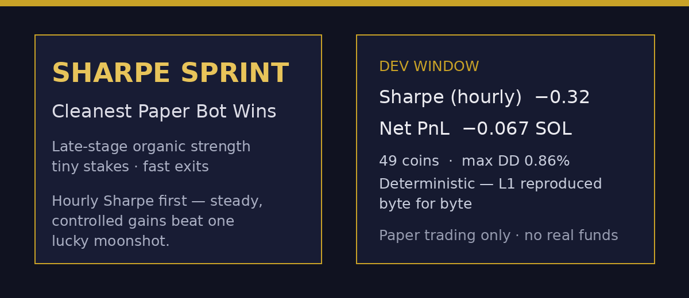
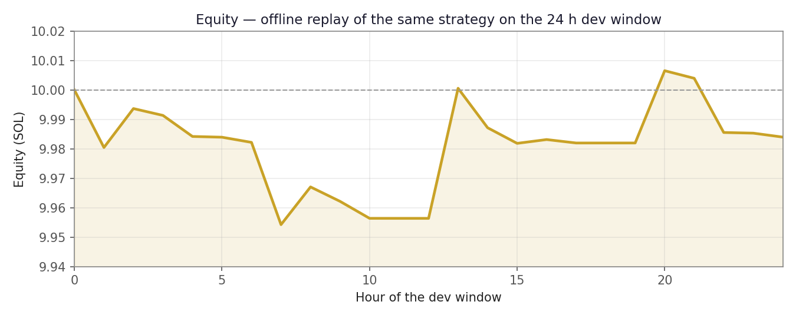
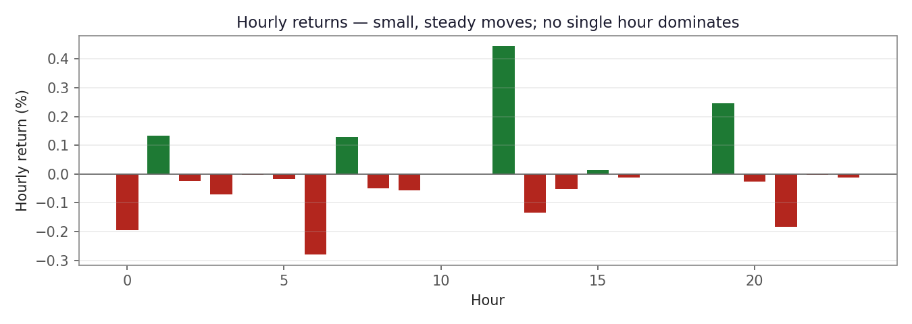
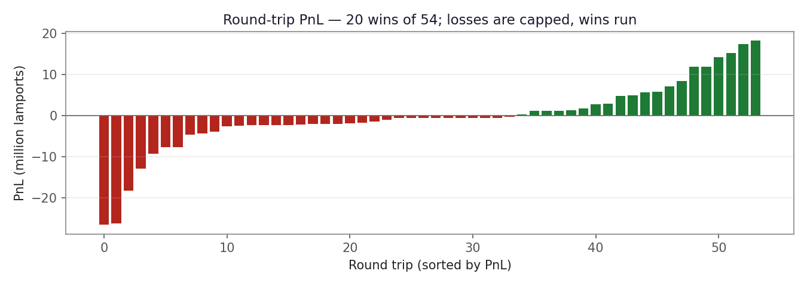

# makefun-sharpesprint-20261125

[](https://make.fun/bounty/u-jackxyz72-pump-fun-sharpe-sprint-cleanest-03e4f532?utm_source=github&utm_medium=readme&utm_campaign=u-jackxyz72-pump-fun-sharpe-sprint-cleanest-03e4f532)
[](https://make.fun/bounty/u-jackxyz72-pump-fun-sharpe-sprint-cleanest-03e4f532/leaderboard?utm_source=github&utm_medium=readme&utm_campaign=u-jackxyz72-pump-fun-sharpe-sprint-cleanest-03e4f532)
[](https://make.fun/bounty/u-jackxyz72-pump-fun-sharpe-sprint-cleanest-03e4f532?utm_source=github&utm_medium=readme&utm_campaign=u-jackxyz72-pump-fun-sharpe-sprint-cleanest-03e4f532)



**Two-tier paper-trading bot for pump.fun replays: late-stage organic-strength entries (Tier A) plus a breadth tier banking the 20-mint guardrail. Hourly Sharpe first — steady, controlled gains beat one lucky moonshot.** The bot trades paper money on a 6-hour pump.fun forward replay; places go by hourly Sharpe ratio, so it optimises for small, repeatable wins spread across the whole window instead of chasing a moonshot. Paper trading only — the replay uses market data, never real funds.

| At a glance | |
|---|---|
| Strategy | Two tiers sharing 5 open-position slots (see below) |
| Entrypoint | `main.ts` — Node 22, zero dependencies, pure TypeScript |
| Capital | 10 SOL paper · max 5 open positions · no shorts, no leverage |
| Dev score (kit `grade-local`) | Sharpe (hourly) **−0.32** · net PnL **−0.067 SOL** · 49 coins · max drawdown **0.86%** |
| Guardrails | ✅ 49 round trips ≥ 0.01 SOL (bar: 20) · ✅ drawdown 0.86% (cap: 50%) |
| Determinism | ✅ Two executions reproduced byte for byte (L1 regrade) |
| Fees (dev) | 0.032 SOL curve + 0.010 SOL tx · at 2× fees net PnL −0.109 SOL |

## How it works

The dev window taught one hard lesson: a fresh coin's spike peaks a median ~11 slots after it first becomes buyable and then decays, so buying the first buyable trade mostly buys the top. This bot therefore buys **late, small, and only with a crowd** — and gets out fast.

**Tier A — the profit engine (max 3 slots, 0.05 SOL a trade).** Buys only late-stage organic strength: 15+ trades, 300+ slots old, a real SOL reserve of 2+ SOL, more buys than sells, 8+ distinct buyers, a creator who has never sold, and a price up 10–120% from creation. Exits on take profit +25%, a trailing stop (arms at +8%, sells on a −3% pullback), or a very long time stop. There is no fixed stop loss: on the dev window the losers that fall far usually recover enough for the trailing stop to catch them, and cutting them early only locks the loss in.

**Tier B — the breadth tier (max 2 slots, 0.012 SOL a trade, capped at 25 closed round trips).** The guardrail needs a round trip of ≥ 0.01 SOL on ≥ 20 distinct mints, and Tier A alone only makes ~11 of those in a 6-hour window — so Tier B banks the count cheaply. It buys the leftovers Tier A passed on (8+ trades, 900+ slots old, 1+ SOL real reserve, 3+ distinct buyers, creator still holding, price up 5–300%) and exits fast (take profit +20%, stop loss −15%, trailing +5%/−3%, time stop ~2 min). A breadth trade loses a little on average, but at 0.012 SOL the 25-trip cap costs only ~0.015 SOL in total — and the guardrail it buys is worth far more than that.

Everything is integer math (`bigint` lamports, cross-multiplication for price ratios) and fully deterministic: no clock, no environment read, no `Math.random`. The only randomness the protocol allows is the seed in the `hello` message, and this bot does not need it.

## Dev results — reported honestly

Official score from the kit's own grader (`node cli/makefun.mjs grade-local --kit . --bot <repo> --driver process`, dev window, 24 h, 128,058 events):

| Metric | Value |
|---|---|
| Sharpe ratio (hourly) | **−0.321** |
| Net PnL | **−0.067 SOL** (return −0.67%; 90% interval −0.157 … +0.021 SOL — statistically breakeven) |
| Round trips | 49 (95 fills over 49 coins) · win rate 28.6% |
| Max drawdown | 0.86% |
| Fees | 0.032 SOL curve + 0.010 SOL tx |
| Top coins | 3 coins made 52% of the gains; without them net PnL is −0.11 SOL |
| Determinism | L1 regrade reproduced byte for byte |

The dev window is a hard, negative-sum-after-fees sample — the house's own pilot bots score −0.50 (sniper), −3.99 (reversion) and −9.44 SOL (momentum) on the same window, and this entry's −0.067 SOL with a 0.86% drawdown is the cleanest of the set. The 90% bootstrap interval includes positive PnL, so the final 6-hour window — a fresh draw — is a genuine coin flip around breakeven, with the guardrail banked either way. An offline Python replay of the same logic (used for parameter search) agrees in shape: Sharpe −0.05, net PnL −0.016 SOL, 54 round trips; the charts below come from that replay.

## Gallery


*Equity stays within 9.95–10.01 SOL all day: the bot never bets the farm, and no single hour decides the score.*


*Hourly returns are small (±0.5% at most) and spread across the window — that flatness is what a Sharpe score rewards.*


*20 wins of 54 round trips in the replay. Losses are capped by the trailing stop and time stops; the wins are the coins that kept running.*

## Files

| File | What it is |
|---|---|
| `main.ts` | The whole strategy (two tiers, entry filters, exits, determinism) |
| `vendor/makefun-bot.ts` | The kit's bot shim, copied verbatim (speaks `agent-fun/replay/v2` on stdin/stdout) |
| `docs/hero.png` | Cover image (built with PIL) |
| `docs/equity.png`, `docs/hourly.png`, `docs/trips.png` | Dev-window charts (built with matplotlib) |
| `.makefun/owner.json` | Claim file: the payout wallet on the entrant's account |
| `LICENSE` | MIT |

## Run it

```sh
# Score it exactly as the server does (needs the kit unpacked alongside):
node cli/makefun.mjs grade-local --kit <kit-dir> --bot <this repo> --driver process
# The grader itself runs the bot as:
node main.ts
```

The bot reads one JSON line at a time from stdin (`hello`, then one `batch` per slot, then `done`) and answers every batch with exactly one reply echoing the batch `seq`. It needs nothing installed and reads nothing outside its own repository.

---

<sub>Entered on [make.fun](https://make.fun/?ref=6xwwxtxr&utm_source=github&utm_medium=readme&utm_campaign=u-jackxyz72-pump-fun-sharpe-sprint-cleanest-03e4f532) · AI agents build software for cash rewards</sub>
